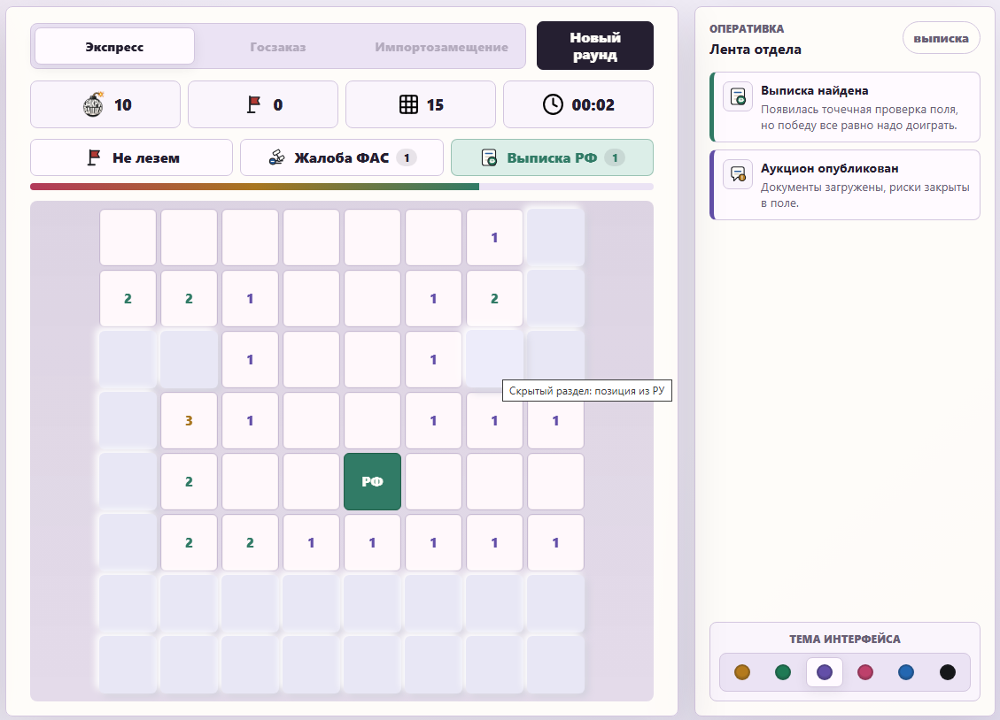
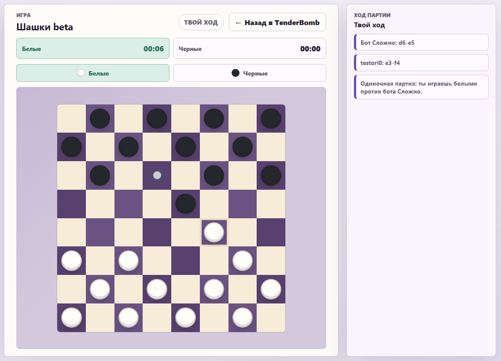
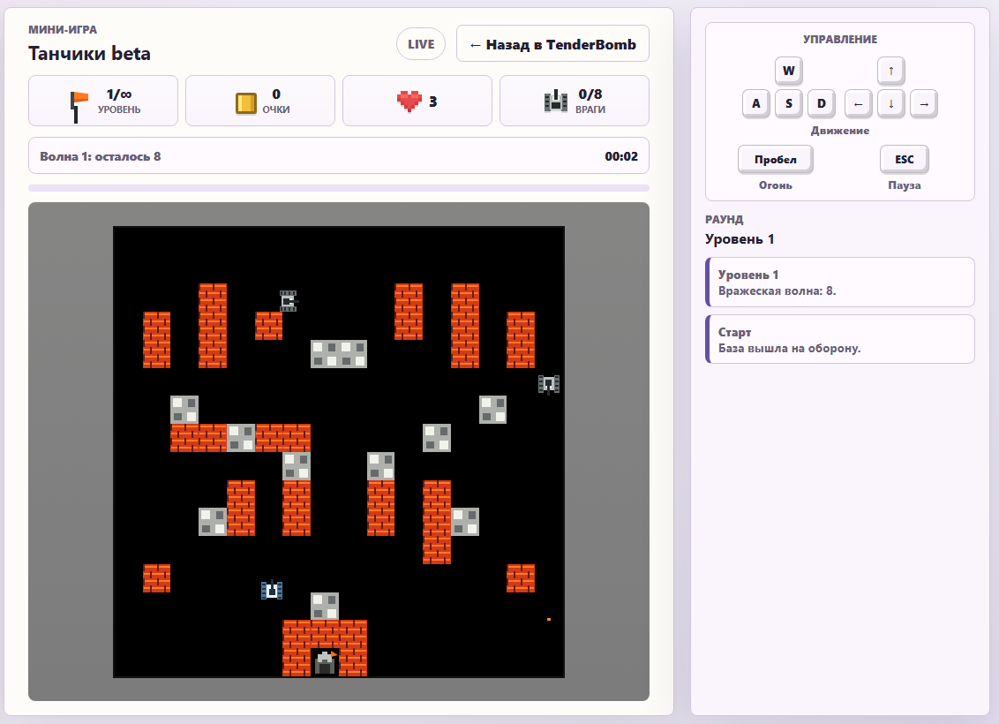
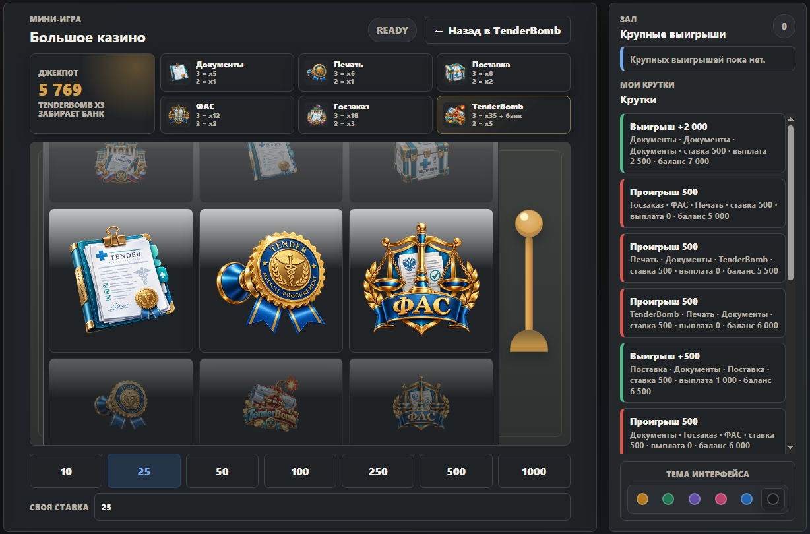

**Тендеры закончились. Началась игра.**

Локальная браузерная аркада: четыре режима, общие профили, рекорды и кредиты.

[Скачать](https://github.com/schiz027/TenderBomb/releases/latest) · [Запуск](#запуск) · [Участие](CONTRIBUTING.md) · [Безопасность](SECURITY.md)

## Игровые режимы

| 💣 TenderBomb | ♟️ Шашки | 💥 Танчики | 🎰 Казино |
|:---:|:---:|:---:|:---:|
| Сапёр про закупки: три сложности, ФАС и бонусы | Бот и PvP | Аркадные бои и волны врагов | Слоты, ставки и джекпот |

Кредиты, заработанные в играх, можно использовать в казино. Результаты и профили хранит общий сервер.

<table>
<tr>
<td width="50%"></td>
<td width="50%"></td>
</tr>
<tr>
<td></td>
<td></td>
</tr>
</table>

## Запуск

На компьютере сервера нужен **Python 3** без сторонних библиотек. Игрокам достаточно браузера.

1. Скачайте и распакуйте архив из [Releases](https://github.com/schiz027/TenderBomb/releases/latest).
2. Запустите скрипт для своей системы:

| Система | Команда |
|---|---|
| Windows | `start-server.bat` |
| Windows, в трее | `start-server-tray.bat` |
| macOS, Terminal | `chmod +x start-server-macos.command && ./start-server-macos.command` |
| Вручную | `python server.py 8080` (на macOS — `python3`) |

3. Откройте [localhost:8080](http://localhost:8080/). Другим игрокам в той же сети передайте LAN-адрес, показанный скриптом запуска.

> Запускайте игру через сервер: открытия `index.html` недостаточно для общих рекордов и экономики. Проект предназначен для доверенной локальной сети; рекомендации — в [SECURITY.md](SECURITY.md).

## Разработка и документация

HTML/CSS и JavaScript отвечают за интерфейс; Python — за API, проверку результатов и локальное JSON-хранилище.

| Файлы | Назначение |
|---|---|
| `game.js`, `checkers.js`, `tanks.js`, `casino.js` | Игровые режимы |
| `server.py`, `sapper_engine.py`, `tanks_engine.py`, `server_security.py` | Сервер и проверка игровых действий |
| `assets/` | Графика и скриншоты |

[Правила участия](CONTRIBUTING.md) · [История изменений](CHANGELOG.md) · [Выпуск релизов](docs/RELEASING.md) · [Игровые сессии и экономика](docs/SERVER_SESSIONS.md) · [MIT](LICENSE)
